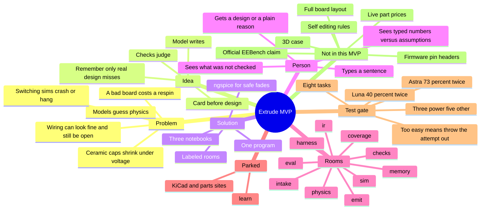
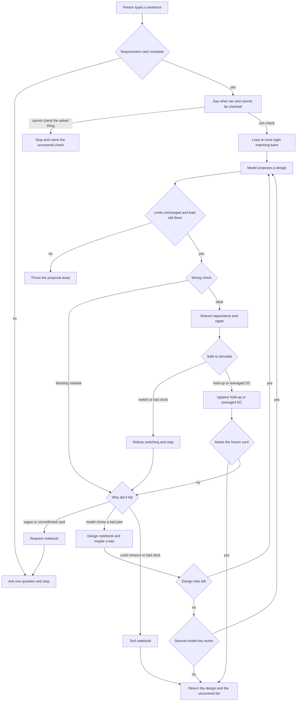
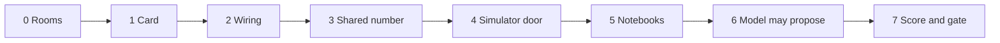
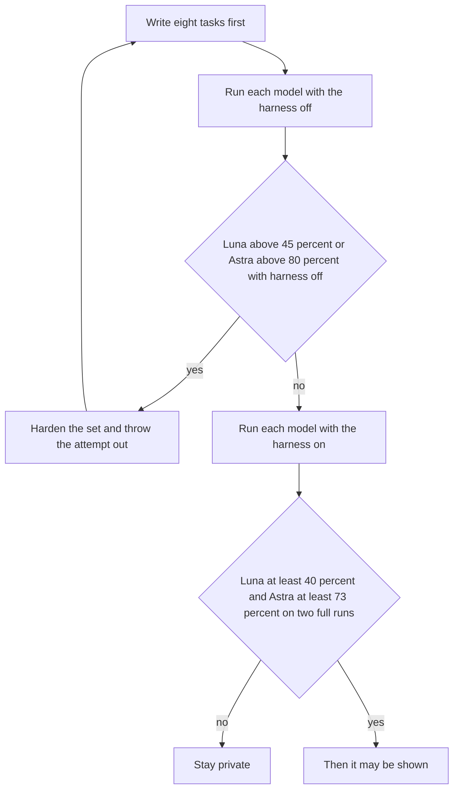
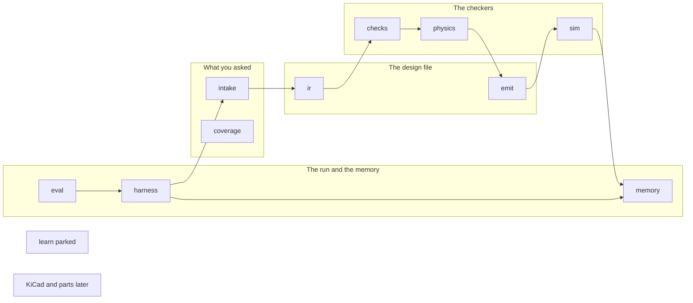

# Extrude MVP map

This is the whole product after all seven phases, not a snapshot of what is already coded. Copy the pictures into a notebook. The words under each picture are the notes that go with them.

Extrude is a local helper for simple power circuits. A person describes a need. A model may suggest a design. The program, not the model, decides whether that design meets a frozen card of requirements.

Nobody outside the build sees it until the practice score is met. That bar is Luna at least 40 percent and Astra at least 73 percent, each on two full runs of the same eight tasks.

---

## 1. Problem

Models can talk about circuits. They do not run the physics. A ceramic capacitor labeled 22 µF can be about half of that once a DC voltage is on it. A schematic can look connected and still have a floating pin, two outputs fighting, or a power pin with no real path to ground. A switched power supply handed to a simulator often crashes or sits there for minutes.

In software, a bad guess is cheap to rerun. In hardware, a bad board is a respin: money and weeks. The public circuit benchmark, EEBench, grades designs by simulation and parts cost. On a later public card, Luna sits near 31 percent and Astra near 69 percent. Those numbers are a mixed set of circuit types. They are not a promise that a harness will jump to the top of that board.

A separate product, Cherry Blossom, has reported a high first-pass fab rate behind manufacturing checks. That is a different measurement. It is not this MVP's score.

## 2. Idea

Do not teach a new model from scratch. Do not drive a desktop CAD program by clicking buttons. Put a normal model in a seat, and wrap it in checks that can say yes or no.

The model writes. The checks judge. A vague sentence is finished into a card before any design starts. A number counts only if the person typed it. Past failures are remembered only when they were really the model's fault.

## 3. Solution

One program, many labeled rooms. They call each other directly. The only outside programs are ngspice, and later KiCad or a parts site. The learning room is not on the path that talks to the user. It does not rewrite the rules during a design.

The finished MVP, after phase 7, does this:

1. Read a sentence.
2. Freeze a requirement card, or ask one question and stop.
3. Say what can be checked and what cannot (airflow, radios, fast memory).
4. Let one model propose a simple power design, at most twice, and only when the miss was a real design miss.
5. Reject obvious wiring mistakes.
6. Use one shared capacitance number for ceramic parts under voltage.
7. Run a hold-up fade in ngspice. Refuse a full switching transient.
8. File the miss in exactly one notebook.
9. Score eight practice tasks. Stay private until both models clear the bar twice.

## 4. Mind map

## 5. Flow of one request

This is the path after phase 7, when the front door is allowed to walk the rooms.

Reading the picture in order:

- The card is frozen first. "Power an ESP32" does not invent a 1 mV ripple.
- A finished buck card shows the numbers the person typed, and 30 mV of ripple marked as an assumption.
- The model cannot tighten those numbers or delete the load to make a check pass.
- Wiring fails closed: hanging pin, two drivers on one wire, two ideal sources on one driven net, power pin with no DC path to ground, rail with no capacitor.
- Ceramic capacitance under voltage and the ripple math use the same reduced number. Zero volts keeps the nominal value. A generic "loses about half" screen can warn only.
- ngspice may run a hold-up fade. A switching transient never starts.
- A 12 V part failure does not block that part at 3.3 V. It can block it again near that same stress. An unknown tape suffix does not invent a match.
- Two tries are spent only for design misses. A crash does not spend them and does not ban a part.
- The answer lists what was checked and names airflow, radios, and fast memory as not checked.

## 6. The seven phases

| Phase | What it adds | How you know it is real |
| --- | --- | --- |
| 0 | Labeled rooms, job cards, tests that refuse a fake pass | The map can be read. A forbidden import fails a test. |
| 1 | Requirement card | Vague text does not invent limits. A hand edit of a limit is rejected. |
| 2 | Wiring check | Bad sketches name the rule. Clean sketches are not failed. |
| 3 | One capacitance and ripple number | The 22 µF example at 4.7 V becomes 11.4 µF from a file, then lower with tolerance. Light load does not invent ripple. |
| 4 | ngspice for a hold-up fade | The deck uses the reduced capacitance. Switching never starts. A crash is a tool problem. |
| 5 | Three notebooks | 12 V does not ban 3.3 V. A vague request beats a bad part. At most eight bans are shown. |
| 6 | The model sits in the seat | A canned bad design can be fixed on the second try. A live call records the real token bill. |
| 7 | Eight-task score | The bar below. The tasks are written before the harness is turned on. |

Phases 0 through 7 are in the repo. The show-people checklist is not signed. No Luna or Astra run has cleared the bar.

## 7. Test gate before anyone else sees it

The eight tasks are original. Three are the power jobs this harness knows: hold-up, buck, simple regulator. Five are other small circuits, so a good score on power alone cannot pass.

Each task is scored `0.65 × technical + 0.35 × cost`. Cost counts only when the circuit works. The headline number is the average of the eight.

This is our own score. It is not an official EEBench score. The private benchmark is not copied into the set. If the bar is missed, a hard task is not dropped to make the average move.

## 8. Technical rooms

| Room | Job when the MVP is finished |
| --- | --- |
| intake | Sentence to card, or one question |
| coverage | What can be simulated, estimated, or not checked |
| ir | Parts, nets, pins. The file is the truth |
| emit | Deck or later board file. Does not judge |
| checks | Obvious wiring |
| physics | Shared capacitance, ripple, still-air heat estimate |
| sim | ngspice, or a refusal |
| harness | Walks the rooms. One model seat |
| memory | Request notebook, design notebook, tool notebook |
| eval | The eight-task score |
| learn | Offline only. Not called on a user request |
| mcp | Later. Not required to pass the show-people bar |

## 9. Business

Who it is for, in this MVP: a person designing a small power piece, not a full product. The promise is a checked suggestion, with the gaps named, not a board you can order.

What has to be true before a friend, a robotics team, or a demo: the gate in section 7. Until then the work stays private.

What it is not selling yet: a CAD program, a parts cart, an enclosure, or firmware. Those are later. They are not used to chase the score.

Money: the model bill is whatever the provider charges on that call. Planning prices are not treated as facts. Phase 6 writes down the real token cost. A cheap model runs first. A stronger model is used only after two real design misses, and only if that key exists.

The honest comparison to the public board: Luna near 31 percent might land near 40 percent on a mixed set if the checkers are attached to a normal design loop. Astra near 69 percent might land near 73 percent. Those are the bars, not a claim that the official leaderboard moved.

## 10. What stays outside the MVP

Layout of a full board, live prices, a 3D case, firmware headers, and a learner that edits the rules. The result must say those things were not checked. Airflow, radios, and fast memory stay on that list.
