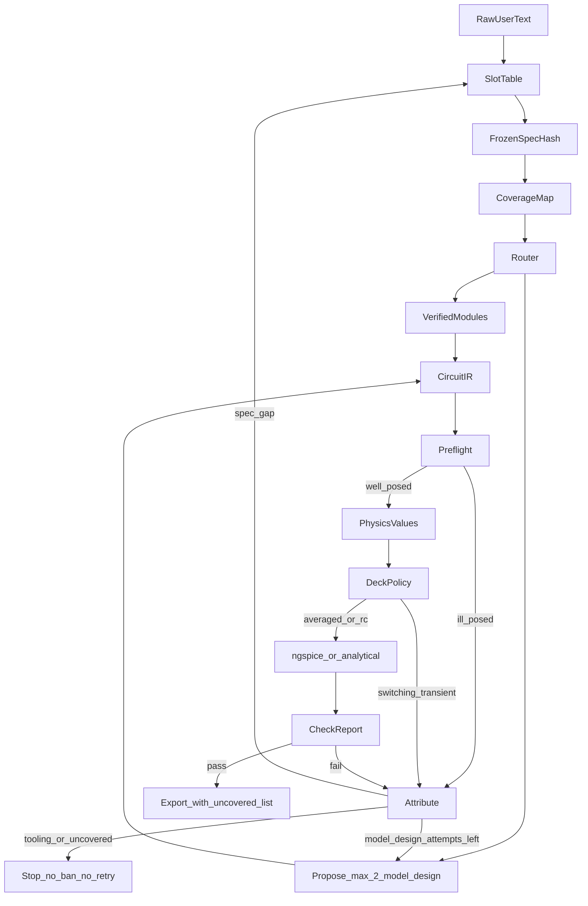

# Extrude Architecture Blueprint

Status: locked for a later phase-by-phase build plan. This document is the software architecture. It is not the build schedule and it does not create the Python package.

Provenance: the market narrative comes from the [Master Strategy Report](https://docs.google.com/document/d/1Hpix5jCdWAsVRpY-fbOhliEdcTqQJjPST0mpiJ3FTwY/edit). The NotebookLM share required sign-in and was not used. Public method and yield claims were checked against [EEBench methodology](https://eebench.org/methodology.html), the [BenchLM EEBench card](https://benchlm.ai/benchmarks/eebench), and [Cherry Blossom’s 5 Sept 2026 note](https://www.trycherryblossom.com/blog).

---

## 1. Executive software architecture

Extrude (`extrude-ai`) is a local Python harness around one proposer model. The model writes a typed circuit. Deterministic checkers decide whether that circuit meets a frozen spec. The model never grades itself.

The source of truth is a versioned `CircuitIR` (JSON, git-diffable), indexed in SQLite. A property graph is derived from that IR for invalidation. Datasheet PDFs in a vector index are rejected for voltages, capacitance, and pin maps.

Week-1 execution path:

`raw text → slot table → frozen spec hash → coverage map → propose → preflight → one PhysicsValues object → allowed simulator → attribute → one ledger`

Official EEBench scoring and a physical fab run are different instruments.

| Claim | What it actually measures | How Extrude uses it |
| --- | --- | --- |
| EEBench score = `0.65 × technical + 0.35 × cost-efficiency` | Atopile bundles, SPICE, tolerance corners, BOM price. Layout, fab, and bring-up are out of scope. Tasks are held out. | Local proxy tasks use the same formula only when we wrote the task and own a reference BOM. Official scores come from atopile’s maintainers. |
| BenchLM snapshot: Opus 5.5 75.0%, Astra 69.3%, Luna 31.1% | A later public card, not a promise that a harness beats the leaderboard. Astra’s strategy-doc error bar is about ±10.7% on a small corpus. | Luna ≥50% is a hypothesis on **our** proxy set. Astra ≥90% on official EEBench would be new state of the art and is not a week-1 gate. |
| Cherry Blossom 97% on 40 boards | First-pass fab yield behind a manufacturing gate. Their own docs say the product does not simulate and is not an RF sign-off. The site’s separate 94% figure is a different claim. | Evidence that a gate can catch connectivity and footprint misses. It is not an EEBench lift. |

Scaffold choice moves scores about as much as model generation (EEBench’s GPT-5.5 harness comparison). The product is the harness.

Nodes are stages in one process with one proposer. They are not a multi-agent chat swarm.

---

## 2. Four loopholes, researched, and the fixes that stay

### 2.1 Switching transients in ngspice

**What is real.** A full switched buck in ngspice regularly dies with `timestep too small`, a singular matrix, or a multi-minute run. KiCad forum reports of TI models (LM76002 and similar) stall around the first millisecond. The solver shrinks the timestep through the switching edge until it gives up. Parasitic L and C inside vendor models make this worse. That crash is a solver event.

**The incomplete fix.** An averaged or behavioral source is the right week-1 circuit for DC voltage, load current, and dissipation. It is the wrong ripple meter. A pure average has no switching edges, so `.meas` of peak-to-peak ripple reads about zero and the design false-passes.

**Locked rule.**

- Power-stage checks split by physics:
  - **DC and load:** averaged deck, `.op` / `.meas` of `V(out)` and `I(load)`.
  - **CCM ripple:** Python, not the switching transient.
    - `D = Vout / Vin` (ideal; efficiency can scale D later and must be labeled).
    - `ΔI_L = Vout × (1 − D) / (f_sw × L)`
    - `ΔV_pp ≈ ΔI_L × (ESR + 1 / (8 × f_sw × C_eff))`
  - If `ΔI_L > 2 × Iout`, the inductor current reaches zero. The CCM formula is invalid. The check becomes `conduction_mode_uncovered` until a DCM equation exists. It is not a model ban.
  - **Hold-up and other RC decays:** ngspice `.tran` is allowed. There is no switch. `C` in that deck is `C_eff`.
- The runner rejects a deck that contains a switch, a PWM source at `f_sw`, or a `.tran` whose max step is aimed at a switching edge. Rejection happens before the process starts. Class: `policy`, which is tooling. No Luna retry. No ban.
- After preflight has passed, a timeout, `singular matrix`, `timestep too small`, or an unparseable log is `tooling`. It does not decrement Luna’s two design attempts and it does not write the ban list.
- A floating pin, a missing ground, or two ideal voltage sources on one node is caught in preflight. That is `model_design`. It may consume a design attempt, because the model can repair the IR. ngspice is not started.

Invocation stays a subprocess, not PySpice’s shared library on Windows:

```text
ngspice -b -o run.log -r run.raw deck.cir
```

Timeout is `subprocess`’s timeout. Parse `.meas` lines first. The raw file is a second path for hold-up waveforms only.

### 2.2 Vague prompts and invented limits

**What is real.** “Power an ESP32” does not state ripple. A proposer that invents 1 mV, then fails at 15 mV, stores a good 3.3 V design as a defect. Later sessions ban parts that were fine, and any future fine-tune learns the wrong lesson.

**Locked rule.**

- Week-1 task classes are a closed enum: `buck`, `ldo`, `holdup_mlcc`, `led`, `mcu_swap`, `unknown`.
- `unknown` asks one question and does not simulate.
- Each class has a slot table. Blocking slots have no default (`buck` blocks on `vin`, `vout`, `i_load`). Non-blocking slots have a versioned default (`ripple_pp = 30 mV`, `defaults_version` in the hash).
- An extractor may copy a number only when that number has a character span in the raw user text. A number with no span is discarded. The slot default is used.
- The proposer receives bounds as read-only. A patch that changes a pass/fail number, deletes the spec load, or edits the spec hash is rejected before simulation.
- SPICE and the analytical ripple check run only after `FrozenSpecHash` is stored. The hash covers the canonical SI values, the task class, `defaults_version`, and the waiver set. “30 mV” and “0.03” hash as the same quantity.
- A check the user waived is `waived`. A waived check cannot fail the model and cannot create a ban.

### 2.3 MLCC value split between checker and simulator

**What is real.** Class II capacitance (X5R, X7R, Y5V) falls under DC bias, and the curve is part-specific. The strategy report’s hold-up example is a nominal 22 µF read as 11.4 µF at 4.7 V, against a 545 µF effective minimum. That number is one worked example, not a constant for every 22 µF part. The same nominal part in a larger case or a higher voltage rating derates less. Measurements on 10 µF, 6.3 V, X7R, 0805 parts from three manufacturers show rated-voltage loss ranging from about 35% to 65%. A “same package and voltage rating” curve from another brand is not an exact table. IEC capacitor rules do not require a C–V plot, so many parts have no curve at all.

**Locked rule.** One `PhysicsValues` object is the only capacitance the checkers read.

- `C_eff` is written into the `.cir` capacitor card, the CCM ripple equation, and the hold-up energy / RC deck before any of them run.
- Worst corner used for a minimum-capacitance spec: `C_use = C_eff × (1 − tolerance)`.
- `curve_source` is one of `vendor_table`, `same_mfr_series_case_v_dielectric`, `generic_screen`, `not_class_ii`.
- Hard fail is allowed only for `vendor_table` and `same_mfr_series_case_v_dielectric`.
- `generic_screen` (“X7R loses about half”) may warn. It cannot fail the design and cannot write a ban.
- C0G, film, and electrolytics do not take the Class II formula. They keep nominal C, with tolerance still applied when the spec is a minimum.
- Temperature, aging, and AC bias stay on the coverage map as uncovered. They are not silently folded into `C_eff`.

### 2.4 Ban scope and orderable-part aliases

**What is real.** A 22 µF, 0805, 10 V ceramic that collapses on a 12 V rail can be the correct part on a 3.3 V rail. A global MPN ban blocks the good use. The same physical part is also sold under tape-and-reel suffixes and distributor codes (LCSC `Cxxxxxx` versus the manufacturer MPN). A ban on one string loses to the other string.

A ban on the “MPN family” (every GRM21, every CL series) is too wide and blocks unrelated capacitance and voltage ratings. A coarse voltage bin (0–5 V versus 5–16 V) false-bans at the edges and leaks across the edge.

Suffix stripping by regex is unsafe: the suffix is not a stable grammar across manufacturers, and two different electrical parts can collapse to one key.

**Locked rule.** The ban key is:

```text
(electrical_identity, check_id, checker_version, severity_predicate)
```

`electrical_identity` is `(manufacturer, capacitance, dielectric, case, voltage_rating)`.

An alias table maps orderable MPN and LCSC code onto that identity. Both strings hit the same ban. Unknown aliases are stored as unseen orderable parts and are not guessed by chopping the string.

The predicate is check-specific. For `dc_bias`, the ban applies when the new DC bias is at least as severe as the failure: `v_new >= 0.9 × v_fail`. A 12 V failure does not apply at 3.3 V. For overcurrent, the mirror is `i_new >= i_fail`.

One component failure never writes a topology-class ban (“all bucks”). At most eight matching bans are injected, each with the measured number and the operating point. Bans expire when `checker_version` changes or the frozen spec hash changes. Causes other than `model_design` never insert a row.

---

## 3. Request path



Luna’s two attempts decrement only when the primary cause is `model_design`. Escalation after those two is Astra or Claude Opus 5.5, whichever is cheaper on that task class. Hard classes (multi-gigabit pairs, DDR, safety-critical high voltage, full-board autoroute, 3D airflow) skip the retry loop. The coverage map already lists them as uncovered.

---

## 4. Folder and module layout

```text
extrude/
  ir/            CircuitIR, canonical hash, graph diff
  intake/        task enum, slot tables, evidence spans, assumption card
  coverage/      checker registry, user-visible notices
  harness/       loop, router, propose prompt, attempt budget
  physics/       PhysicsValues, CCM ripple, hold-up energy, thetaJA estimate
  checks/        preflight, MLCC lookup, pass/fail against frozen spec
  sim/           deck policy, ngspice subprocess, .meas parser
  emit/          .cir, .ato, KiCad netlist, generated pin header
  memory/        negative constraints, prompt defects, harness bugs, modules
  learn/         offline replay only; the CLI does not import this package
  mcp/           kicad, sourcing, mechanical tool schemas
  eval/          proxy metrics
eval/proxy_tasks/   hold-up, buck DC plus analytical ripple, LDO thermal
```

SQLite tables: `specs`, `assumptions`, `parts`, `aliases`, `checks`, `negative_constraints`, `prompt_defects`, `harness_bugs`. The IR JSON remains the design file. SQLite is the index and the ledgers.

---

## 5. Implementation contracts

### 5.1 Frozen spec

```python
class SlotOrigin(str, Enum):
    user_span = "user_span"   # number appears in raw text
    default = "default"       # slot table
    waived = "waived"

class FrozenSpec(BaseModel):
    task_class: Literal["buck", "ldo", "holdup_mlcc", "led", "mcu_swap"]
    values_si: dict[str, float]          # volts, amperes, farads, hertz, ohms
    origins: dict[str, SlotOrigin]
    defaults_version: str
    spec_hash: str                        # canonical SI + class + defaults_version + waivers

# buck blocking: vin, vout, i_load
# buck default, defaults_version "2026-10-03": ripple_pp = 30e-3
```

The proposer prompt includes `spec_hash` and the sentence: bounds are immutable. The parser drops any IR whose embedded hash differs.

### 5.2 PhysicsValues

```python
class CurveSource(str, Enum):
    vendor_table = "vendor_table"
    same_mfr_series = "same_mfr_series"   # same mfr, series, case, Vrating, dielectric
    generic_screen = "generic_screen"
    not_class_ii = "not_class_ii"

class CapValue(BaseModel):
    refdes: str
    c_nominal: float
    c_eff: float
    c_use: float                 # c_eff * (1 - tolerance), the value checkers use
    curve_source: CurveSource
    v_dc: float

class PhysicsValues(BaseModel):
    caps: list[CapValue]
    vout_dc: float | None
    ripple_pp: float | None      # analytical CCM; None if DCM or missing L, f
    conduction: Literal["ccm", "dcm", "not_a_switcher"]
    p_diss_w: float | None
    tj_estimate_c: float | None  # Ta + P * theta_ja; still-air datasheet estimate
```

Deck emit for a Class II cap:

```spice
* C3 nominal=22u C_use=9.12u source=vendor_table vdc=4.7
C3 vhold 0 9.12u
```

`generic_screen` still writes `C_use` into the deck so the simulator and the warning match, and the check severity stays advisory.

### 5.3 Deck policy and attribution

```python
class PrimaryCause(str, Enum):
    spec_gap = "spec_gap"
    model_design = "model_design"
    tooling = "tooling"          # timeout, singular, parse, policy reject
    user_edit = "user_edit"
    physics_uncovered = "physics_uncovered"
    spec_conflict = "spec_conflict"

class AttemptBudget(BaseModel):
    model_design_used: int = 0
    model_design_max: int = 2
    # tooling and spec_gap do not increment model_design_used
```

Log classifier, after preflight passed:

| Log or process result | Primary cause | Ban | Consumes Luna attempt |
| --- | --- | --- | --- |
| `singular matrix`, `timestep too small`, timeout, no `.meas` | tooling | no | no |
| Switching construct in a week-1 power deck | tooling | no | no |
| Preflight floating pin, dual ideal source, no DC path | model_design | only if identity rules match | yes |
| Ripple or `C_use` misses a frozen limit, vendor curve | model_design | yes, scoped | yes |
| Same miss, generic MLCC curve | advisory only | no | no |
| Failed check depends on a default the user did not accept | spec_gap | no | no |

If the spec was never accepted and the part is also wrong, primary cause stays `spec_gap`.

### 5.4 Negative constraint

```python
class ElectricalIdentity(BaseModel):
    manufacturer: str
    capacitance: float
    dielectric: str          # X7R, X5R, C0G, ...
    case: str                # 0805
    voltage_rating: float

class NegativeConstraint(BaseModel):
    identity: ElectricalIdentity
    check_id: str
    checker_version: str
    v_fail: float | None
    i_fail: float | None
    measured: float
    limit: float
    spec_hash: str
```

Match for `dc_bias`: same identity, same `check_id`, same `checker_version`, and `v_new >= 0.9 * v_fail`. Topology name is not part of the key.

### 5.5 Preflight

Pure Python on the IR. Budget is milliseconds for a few hundred pins.

Blocks simulation:

- Electrical pin not connected and not marked `nc`
- Two ideal independent voltage sources on one node
- Power pin with no DC path to ground
- Two drivers on one net (UART TX–TX, SPI MOSI–MOSI) after role normalization

Warns only:

- Power pin whose rail has zero capacitors
- AC-coupled net that already has a DC bias path on both sides (legal, not floating)

Net aliases (`GND`, `VSS`, `AGND` when the spec ties them) merge before the walk. Preflight does not call a model, KiCad, or a distributor.

### 5.6 Propose prompt (shape)

```text
SPEC_HASH: {spec_hash}
TASK: {task_class}
BOUNDS_SI (immutable): {values_si}
ORIGINS: {origins}
DO_NOT_REPEAT (max 8, this block and this severity only):
- {identity} failed {check_id} at v_dc={v_fail}: measured {measured}, limit {limit}
PASSED_AND_LOCKED: {check_ids}
EMIT: CircuitIR JSON only. Do not change BOUNDS_SI. Do not omit the spec load.
```

### 5.7 Router

1. Frozen spec missing → intake. No model.
2. Coverage says the asked check is uncovered → stop with the registry sentence. No model.
3. A verified module matches the frozen spec → instantiate it. No model.
4. Else Luna, with the attempt budget above.
5. After two `model_design` failures → Astra or Opus 5.5, one attempt, same checkers.
6. Tooling stops the loop and files a harness bug.

### 5.8 MCP schemas (contracts; servers wait until a CLI exists)

`kicad.erc`, `kicad.drc`, `kicad.export_netlist`, `kicad.reimport` require `extrude_id` on symbols. KiCad’s bundled Python runs pcbnew. The system interpreter does not.

`sourcing.lookup` returns MPN, LCSC code, stock, price, lifecycle, package, and `fetched_at`. A missing timestamp is an error. The alias table is updated only from this payload, not from model text.

`mechanical.bbox_script` accepts board box, max component height, and keep-outs, and returns a parametric script. It does not watch Onshape.

### 5.9 Local eval log

Per proxy task:

- `technical_pass`: every non-waived check passed
- `score`: `0.65 × technical + 0.35 × cost_efficiency` when a reference BOM exists; cost term is zero unless technical passed
- `recovery_rate`: among tasks whose first proposal failed as `model_design`, the fraction that passed by attempt two
- `usd_per_verified_task`: token bill divided by verified tasks
- `seconds_per_attempt`
- `spec_gap_fraction` and `model_design_fraction` reported separately

The deficiency tracker counts `model_design` only. Proxy tasks are original (hold-up bank, buck DC plus analytical ripple, LDO dissipation). Held-out EEBench items are not copied in.

---

## 6. Memory, learning, and invalidation

Three ledgers, one write each:

| Ledger | Written when | Injected into the proposer |
| --- | --- | --- |
| Negative constraints | `model_design` and a hard check | yes, scoped |
| Prompt defects | `spec_gap`, `spec_conflict` | no |
| Harness bugs | `tooling` | no |

The offline learn package may propose a new default or a new preflight rule. The CLI does not import it. A proposal ships only after replay on the frozen proxy set shows the spec-gap rate down and the proxy score not down. Training pairs, if they are built later, are `(frozen spec, design, checks)`.

Graph diff runs on an explicit KiCad re-import that still carries `extrude_id`. Edge types are `ELECTRICAL`, `PINMUX`, `MECHANICAL_BBOX`, `COPPER`, `DOC`. One cascade, then stop. A deleted net breaks pinmux. A silkscreen edit does not. Firmware is written to a generated header and is not written over application source. Onshape changes enter when the user pulls an export. A manual edit is `user_edit` and is not a training example.

MCU swap rebinds by function (power, I2C, GPIO role). Unmatched functions are `BROKEN`. Power is recomputed. Layout is marked stale.

---

## 7. Coverage notice

Each check on the frozen spec is one of `analytical`, `spice_dc`, `spice_tran_rc`, `mlcc_table`, `lint`, `theta_ja_estimate`, `uncovered`.

The user-facing sentence is rendered from the registry. The model is not the author of that sentence. Export remains available. The artifact lists checks that ran and checks that did not. Uncovered for this architecture until a later phase adds a real solver: 3D airflow, EMI, multi-gigabit routing, DDR timing, DCM ripple, MLCC aging and temperature.

`theta_ja_estimate` is `Tj ≈ Ta + P × θJA` from the datasheet copper condition named on the part. It is a still-air estimate.

---

## 8. Risk matrix

| Risk | Likelihood in week 1 | What we do |
| --- | --- | --- |
| Switched buck transient hangs or singular-fails | High if a full switcher is emitted | Deck policy rejects it. Averaged DC plus analytical CCM ripple. |
| Averaged `.meas` false-passes ripple | Certain if ripple is read from the average | Ripple comes only from the CCM equation on `C_use`. |
| CCM equation used in DCM | Medium at light load | `ΔI_L > 2 × Iout` marks the check uncovered. |
| Invented 1 mV ripple | High if the proposer writes limits | Span-grounded slots, immutable bounds, hash gate. |
| Generic X7R formula hard-fails a good 25 V part | High if the formula is a gate | Generic source is advisory. Hard fail needs a vendor or same-series curve. |
| 12 V ban blocks a 3.3 V rail | High if the key is the MPN alone | Severity predicate on `v_fail`. |
| Tape suffix or LCSC code escapes a ban | High without an alias table | Alias table from sourcing payloads. No regex chop. |
| Family-wide ban blocks a whole Murata series | High if “family” means the series prefix | Identity includes capacitance, dielectric, case, and voltage rating. |
| Preflight false-fails AC coupling or `VSS` | Medium | Aliases merge. AC coupling with bias on both sides is legal. |
| KiCad save looks like a total redesign | High without `extrude_id` | Diff only those ids. Import does not call the model. |
| Learn loop memorizes the proxy set | High if it runs online | Learn is offline. Replay is required. CLI cannot import it. |
| Token cost erased by Astra on every tooling crash | High if crashes burn escalation | Tooling stops. It does not escalate. |
| User reads a SPICE pass as fab-ready | High | Export banner lists uncovered checks. Cherry Blossom’s 97% is not our score. |

---

## 9. Decisions locked before any phase plan

These are settled. A later phase plan sequences them. It does not reopen them.

1. `CircuitIR` is the source of truth. Atopile and KiCad are emitters.
2. One proposer. Checkers are Python.
3. Spec hash freezes before any solver. Defaults are versioned. Extracted numbers need a text span.
4. Week-1 power simulation is averaged DC plus analytical CCM ripple plus RC transients for hold-up. Switching transients are rejected.
5. One `PhysicsValues.c_use` feeds the deck, the ripple equation, and the hold-up check.
6. MLCC hard fails need a vendor curve or the same manufacturer series, case, voltage rating, and dielectric.
7. Bans use electrical identity, check id, checker version, and a severity predicate. They are written only for `model_design`.
8. Luna’s two retries count only `model_design`. Tooling files a bug and stops.
9. Official EEBench stays external. The local number is the proxy score, with spec-gap and model-design counted apart.
10. Live Onshape watch, self-editing rules, DCM ripple, switching-device SPICE, and fab yield are outside this blueprint’s first build.

Phase planning can start from that list. The package above is the map of modules those phases will fill.
