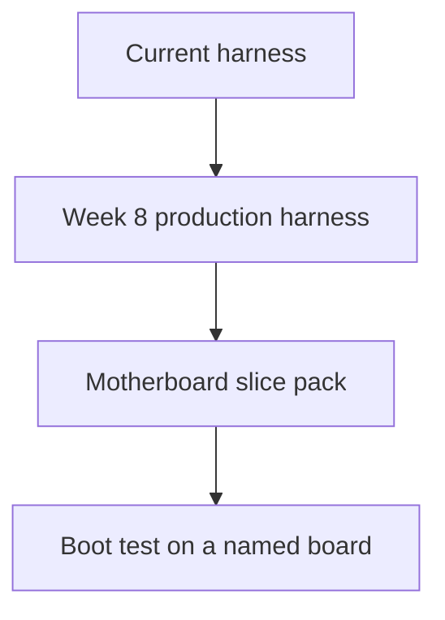

# Extrude production blueprint

This folder is the execution map from the current harness to a measured 80%+ on motherboard designs. The harness is the product. The model stays a raw foundation model. Accuracy comes from checks the model cannot talk its way past.

## How to read this

Read the files in numeric order. A later file assumes the earlier gate is still green.

| Order | File | What it decides |
| --- | --- | --- |
| 01 | [01-north-star.md](01-north-star.md) | The 80% claim and the two scores that are allowed |
| 02 | [02-eight-week-contract.md](02-eight-week-contract.md) | What weeks 1–8 must ship, and what they must not claim |
| 03 | [03-system-today.md](03-system-today.md) | Drawers, request path, and parked learning |
| 04 | [04-architecture.md](04-architecture.md) | Layers, tool boundary, and the failure payload |
| 05 | [05-execution-flow.md](05-execution-flow.md) | One design request from sentence to artifact |
| 06 | [06-data-stores.md](06-data-stores.md) | SQLite, task packs, and what may be remembered |
| 07 | [07-milestones.md](07-milestones.md) | Week-by-week exit tests |
| 08 | [08-motherboard-climb.md](08-motherboard-climb.md) | Pins, power, DRC, one fast link, then boot |
| 09 | [09-learning-rule.md](09-learning-rule.md) | Why more retries are not training |
| 10 | [10-sources.md](10-sources.md) | EEBench, Quilter, KiCad CLI, and the limit of each |

## Program shape

Week 8 delivers the production harness and the first motherboard slice pack. The 80% figure is the pass line on that pack, then on the boot test, only after both packs exist and are scored with the harness off and on.

## v0.1, already in the tree

The local copilot is the current front door. Operator notes are in [docs/v0.1-MVP.md](../docs/v0.1-MVP.md). `POST /v1/copilot` audits OpenSCAD, FeatureScript, and KiCad netlists, including capacitor derating when the netlist carries the part fields. A failed audit is stored and returned on the next audit of that file. Luna is optional and the spend cap is checked before each call. Motherboard scoring stays in the files above and is not claimed by v0.1.
