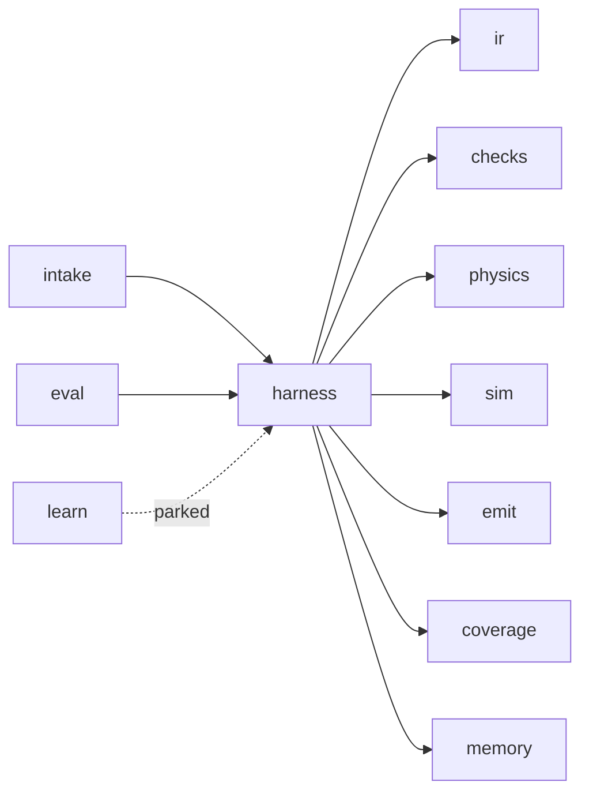

# System today

Code lives in `extrude/`. Drawers call each other in one process. The only outside programs are ngspice now, and KiCad later. There is no network hop between drawers. That rule is in `docs/GROUND-RULES.md`.

## Drawers

| Drawer | Role now |
| --- | --- |
| `extrude/intake` | Sentence to a frozen card, or one question. No invented 5 V. |
| `extrude/harness` | Front door. `walk` in `loop.py`. Prompt, proposal parse, retries. |
| `extrude/ir` | Parts, nets, pins. Source of truth for a design. |
| `extrude/checks` | Wiring preflight and the small board checker in `checks/board.py`. |
| `extrude/physics` | Derating and ripple numbers. |
| `extrude/sim` | The only drawer that starts ngspice. |
| `extrude/emit` | SPICE deck and a KiCad sexpr netlist. Not a routed board. Not Gerbers. |
| `extrude/coverage` | Honest pass stamp. Failed checks are not listed as passed. |
| `extrude/memory` | In-memory rows, plus SQLite when `EXTRUDE_MEMORY_DB` is set. |
| `extrude/eval` | Practice tasks, BOM prices, blend, show-people gate. |
| `extrude/api` | `POST /v1/design`. Needs-info does not call the model. |
| `extrude/learn` | `propose_offline` raises `NotImplementedError`. |

## Request path

`POST /v1/design` with `{prompt, mode: interactive}`:

1. `resolve` the sentence.
2. If the card is `NeedsInfo`, return the question and `render(None, [])`. Log telemetry. Do not call the model.
3. If `EXTRUDE_MEMORY_DB` is set, `retrieve` the top three constraints, then `bind_constraints`.
4. `run` the harness. Passive families are built in code, not by the model.
5. On a checked design, attach `emit_netlist` and the coverage notice.
6. `remember_run` only through the memory writer. Duplicate constraint rows are rejected on `spec_hash + check_id + manufacturer + capacitance`.

## Families the harness will design

Power, model-written: buck, ldo, hold-up. Passive, code-built: divider, pull-up, series, indicator, LED when a supply is present. Anything else stops. The stop is intentional. Unknown work must not be graded as a pass.

## Practice evidence already in the tree

- Luna harness-off about 36%, harness-on about 86%, two runs, under the easy line. `eval/proxy_tasks/results-cost.json`.
- Sol harness-on about 83% and 85%. `eval/proxy_tasks/results-sol.json`.
- Gate unsigned, because Luna and Astra were not both logged. This program does not sign that gate.
- Four-pad board probe: both models passed first try, harness off and on. That board is too easy to be a milestone. `eval/proxy_tasks/results-pcb.json`.

## Defaults that must stay marked

`SlotOrigin.default` on buck ripple 30 mV, LED forward drop 2.0 V, divider bottom resistor 10 kΩ when only the ratio is known, and SMBus or I2C bus voltage 3.3 V when none was typed. A default is not a user fact.
