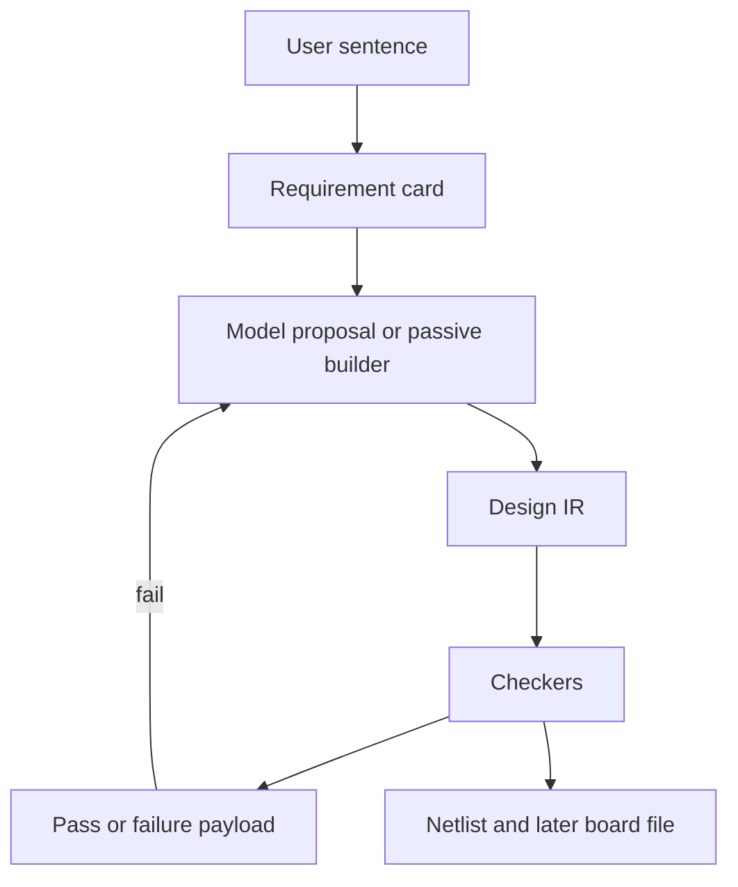

# Architecture

The model writes a structured design. Deterministic code decides pass or fail. The model never grades itself.

## Layers

| Layer | Owns | Must not own |
| --- | --- | --- |
| Intake | Parsing, missing-fact questions, spec hash | Simulation, prices, layout |
| Proposal | JSON that `proposal.py` can normalize into parts and pins | Whether the design works |
| IR | Refs, nets, pins, values | File formats |
| Checks and physics | Pass, fail, measured number, limit | Calling the model |
| Sim | ngspice, and only the decks `sim/policy.py` allows | Routing |
| Emit | Netlist text, SPICE deck, later `.kicad_pcb` | Changing the IR to hide a violation |
| Memory | Constraints that a checker produced | Remote embeddings, model-written “facts” |
| Eval | Frozen tasks, blend, reports | Designing the circuit |
| Learn | Offline, after a gate exists | The live request |

## Tool boundary

| Tool | How it is found | What a failure means |
| --- | --- | --- |
| ngspice | `NGSPICE_PATH`, else PATH | Electrical miss if the deck ran and the measurement missed. Tool miss if the binary is absent. |
| KiCad CLI | `KICAD_CLI_PATH`, else PATH | Design miss on exit 5. Tool miss if the binary is absent or the board file cannot be read. |
| Parts data | JSON files in-repo for the slice pack | Pin or MPN miss. No live distributor call in this program. |

A tool miss is logged and returned. It does not increment the design-attempt counter and it is not stored as a negative constraint against a part.

## Failure payload

On a failed design the retry prompt contains only:

- `DO_NOT_BREAK`: requirement ids that already passed, with the measured value.
- `MUST_FIX`: one checker id, the refs, the nets or pins, the required number, the measured number, and the delta.

The payload is produced by the checker, not by a second model. `loop.py` already does a narrow version of this for a disconnected hold-up capacitor. Motherboard checks use the same shape.

A retry may change the failing objects. It may not rewrite a locked pass to chase the new failure. If the locked item regresses, that attempt fails for the regression, and the payload names it.

## Attempt budget

Practice power jobs already retry inside `walk`. The slice pack uses the same budget unless a task file sets a lower one: one harness-off shot, and harness-on stops at three design attempts. Tool misses do not count.

## API

`extrude/api/server.py` stays the only HTTP surface. Response fields stay `status`, `detail`, `question`, `card`, `notice`, `netlist`, `attempts`, `cost_usd`, `seconds`, `constraints`. A later board file path is added only when emit can write a `.kicad_pcb` that DRC can open. Until then the field is absent, not an empty success.
