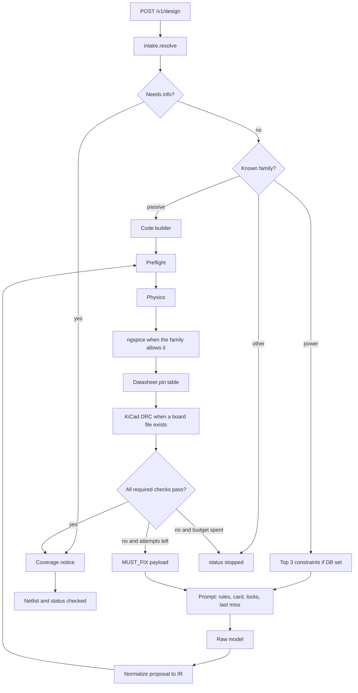

# Execution flow

One design request. No second agent, no swarm, no model-as-judge.

## Prompt order

`extrude/harness/prompt.py` keeps this order:

1. Static emit rules.
2. Spec hash.
3. Task and bounds.
4. Origins, including defaults.
5. Do-not-repeat blocks, at most eight.
6. Passed-and-locked.
7. Last rejection, when there is one.

Retrieval text is a prefix of constraints. It does not replace the static rules. A constraint from another task class with no token overlap scores 0 and is not shown. That ranker is `extrude/memory/rag.py`.

## Passive versus model

Divider, pull-up, series, indicator, and a fully specified LED never call the model. The numbers come from the card. Spice expected values are computed in `extrude/harness/passive.py`. This is the pattern for any motherboard check that is a formula: the model selects a legal part, the checker computes the number.

## Board flow added in this program

When the task has a board:

1. Emit writes `.kicad_pcb` from the IR plus a stackup and outline stored on the task. The model does not emit free-form KiCad sexpr as the graded file. It emits the IR. Emit is the only writer.
2. The process runs `kicad-cli pcb drc --format json --exit-code-violations -o <report.json> <board.kicad_pcb>`.
3. The JSON parser maps each violation to refs and a measured clearance or a rule id.
4. Exit 5 becomes `MUST_FIX`. Exit 0 continues to the coverage stamp.

The four-pad checker in `extrude/checks/board.py` remains a unit-test oracle for coordinates. It is not the production grade once KiCad DRC is on that task.

## Eval flow

`python -m extrude.eval.runner` loads `eval/proxy_tasks/*/task.json`, runs harness off and on, and writes a results file. Motherboard slice tasks live in their own directory so a practice replay cannot be overwritten by a slice run. Summary dollars stay null if any task dollar is null. A null dollar is a missing price, not a free board.
