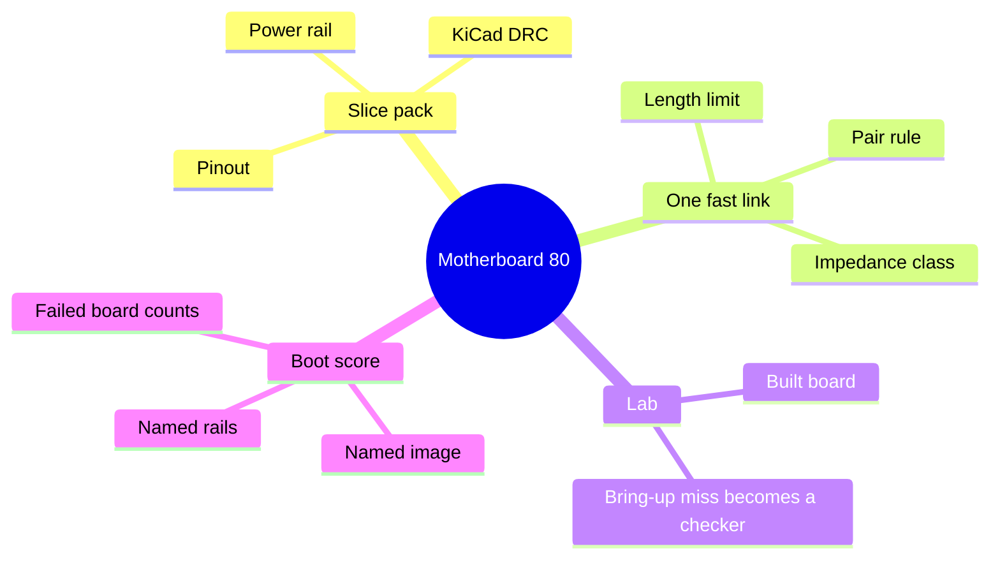

# Motherboard climb

The slice pack is a piece of a motherboard, graded like one. The whole board comes after that piece is measurable.

## Representation

The graded object is the IR plus the board file emit wrote. The model does not submit Gerbers, a screenshot, or a prose layout.

A motherboard is split into task-sized subgraphs so the prompt stays the subsystem under test plus the interface nets. Interface nets are named and typed (`power`, `ground`, `diff_pair`, `single`). The rest of the board is not pasted into the prompt. This is the practical form of “localize the subsystem.” A graph database is not required for the slice pack. Task files name the nets.

## Pins

Week 3–4 pin tables cover the slice. The climb adds one connector and one multi-pin IC only after those three parts are clean. Each new part is a JSON file and a unit test that swaps two pins and expects a fail.

## Power

One rail in the slice pack. The next rail is a new task, not a silent expansion of the first. Copper width for a stated current is a constant in the task with a one-line source note (IPC-2221 or the datasheet current limit). The checker compares geometry in the board file to that constant.

Power-to-ground short is a hard fail. Cost and area cannot offset it. The blend already withholds cost credit when technical is not 1.0. The short must also force technical to 0.

## DRC

Production command:

`kicad-cli pcb drc --format json --exit-code-violations -o drc.json board.kicad_pcb`

KiCad 9 documents exit 0 for no violations and exit 5 when violations exist. Severity flags stay at errors for the gate. Warnings are logged and do not pass a task by themselves until a task file opts into a named warning.

The in-house pad checker stays for fast tests. It does not override a KiCad fail.

## One fast link

After the slice score has been measured, add one interface class. Pick DDR, USB, or PCIe, and write the limit before any layout change: max skew or max length, pair membership, and the net class name. A net in that class routed with the default clearance class fails. Do not add all three interfaces in the same week.

Quilter-style external routing is optional and only as a writer of copper after the schematic and outline exist. The grade is still our checker plus KiCad DRC. A router quote is not a score.

## Lab

When a small run of the slice board is assembled, each bring-up miss becomes either a new checker with a number, or a note in `project_blueprint/results/lab.md` that says why it cannot be checked in software yet. Notes do not count as passes.

## Boot test sheet

Filled in only after the slice score exists. Until the blanks are filled, the boot score is unmeasured.

- Board name and layer count.
- Repo commit of the design that was fabricated.
- Image name and the command that counts as boot.
- Rails and the meter limits.
- Sample size. A board that was not powered is not in the denominator. A board that failed is in the denominator.
- Harness-off designs and harness-on designs fabricated in the same way.

80% boot means at least four in five of those boards, on the harness-on designs, with the harness-off boards reported beside them. A sample of one is not a percent.

## Division of work inside the harness

| Job | Who |
| --- | --- |
| Choose a legal part and a legal connection | Raw model, or the passive builder |
| Compute derating, ripple, clearance, pin match | Checkers |
| Route copper in the board file | Emit, then KiCad DRC; an external router only if it returns a board file the same DRC opens |
| Decide pass | The gate, never the model |
| Remember a miss | SQLite, after the checker |
| Change weights | Out of this program |
